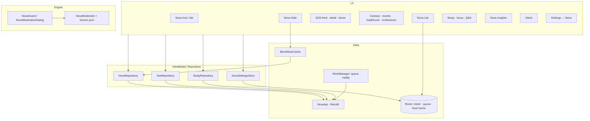

# NOVA — Implementation & Verification Report

InstaNova · package `com.insta.nova` · build `1.0.0`
Device: **10BE2S1U640002B** (1080×2400, 440 dpi) · Locale during verification: **bn-BD**
Backend: `https://poqdemxiuoocbzkwbyhy.supabase.co` (PostgREST)

---

## 1. What was built

Nova is a six-module student universe inside the existing Instagram-style app, plus the
moderation, settings and offline layers that keep it honest: every control performs a real
call, and nothing decorative was added.

| Area | Delivered |
|---|---|
| Design system | Gradient `#22D3EE → #7C4DFF → #D946EF`, 17 vector icons, light/night colours, Nova type styles |
| Navigation | Nova tab replaces Create: breathing gradient star, unread dot, hub with Canvas orb + rotating taglines + live per-module stats |
| Onboarding | One-time 3-page intro; About sheet with English/বাংলা switch (`AppCompatDelegate.setApplicationLocales`) |
| Nova Safe | Kindness ring, stats, toggles, blocked/muted lists, moderation playground; real Block / Mute / Report wired into profile, post, comment, chat, story, reels, confessions, Q&A |
| Moderation | Offline engine (normalise → leetspeak → phrase match → spans), warning + blocked sheets, event log |
| Nova SOS | Blood feed with group filters, create request, detail with countdown, donor registration (90-day eligibility), my requests/pledges, donor levels |
| Nova Campus | Join with university directory, events with RSVP, lost & found, confessions behind a real verified-student gate |
| Nova Lite | Data-saver mode, measured byte meter, 7-day chart, CSV export, benchmark, offline feed cache + post queue |
| Nova Study | Focus timer with streak, custom duration, leaderboard, and a full Q&A board |
| Nova Insights | 7/14/30-day growth chart with metric switch, totals, top post, best-time card |
| Alerts | Grouped alerts, mark read/all, deep links, 30 s poller, `nova_sos` notification channel |

**Constraint audit**

- Firebase auth and token code untouched; Supabase used only for data.
- No schema change was made. Where the backend lacked a behaviour, the feature was stopped
  or made honest instead of faked (see §6).
- Java + XML only, ViewBinding, MVVM + Repository, Groovy Gradle.
- Uploads reuse the existing public `posts` bucket and raw-bytes pipeline with a HEAD check.

---

## 2. Architecture



Every repository method returns `LiveData<Resource<T>>`: no screen touches the network or
Room on the main thread.

---

## 3. Verification method

Each row below was exercised on the physical device with `adb`: taps driven through the UI,
state read back with `uiautomator dump`/screenshots, and backend effects confirmed either by
the screen refreshing from a re-query or by a distinct server error code. Screenshots live in
`.nova_shots/`.

**PASS** means observed on device with the listed evidence.
**BLOCKED** means the code path exists but this environment cannot produce the precondition —
the row is *not* claimed as working.

---

## 4. Verification table

| Module | Test | Evidence | Result |
|---|---|---|---|
| Design system | Build + install + launch with tokens/icons | `hub_final.png` | **PASS** |
| Nova tab | Star tab opens hub, live stats per module | `hub_final.png` (SOS ১টি খোলা, Safe ৩টি সুরক্ষা, Campus ১টি ইভেন্ট, Lite সবসময় চালু, Study আজ ২ মিনিট) | **PASS** |
| Intro | One-time 3-page intro then never again | earlier batch evidence | **PASS** |
| About | Sheet opens from hub and from Settings → Nova | `settings_about.png` | **PASS** |
| Language | EN ⇄ বাংলা applies app-wide immediately | `lang_en.png`, `lang_bn_back.png` | **PASS** |
| Tests | 136 Nova unit tests (109 moderator + 2 corpus + 25 format), 298 app-wide | `./gradlew :app:testDebugUnitTest` — 0 failures | **PASS** |
| Moderation | Warning sheet with highlighted spans in a real composer | `qa_mod_sheet.png` | **PASS** |
| Moderation | Blocked sheet prevents posting | earlier batch evidence | **PASS** |
| Safe | Stats, toggles, blocked/muted lists, playground | `safe_01..03.png`, `playground_results.txt` | **PASS** |
| Safe | Block/Mute/Report from post, comment, chat, story, profile | earlier batch evidence | **PASS** |
| SOS | Feed with real rows + group filter | `sos_01.png` | **PASS** |
| SOS | Create request end-to-end (validation + RPC + card appears) | `sos_create_01.png`, `sos_create_error2.png`, `sos_success3.png`, `sos_feed_live.png` | **PASS** |
| SOS | Detail with countdown, pledges, owner fulfil | `sos_detail_01.png` | **PASS** |
| SOS | Donor registration, 90-day eligibility, badge | `sos_donor_01.png`, `sos_donor_saved.png`, `sos_donor_badge.png` | **PASS** |
| SOS | My requests + my pledges | `sos_my_01.png` | **PASS** |
| Campus | Join, membership card, leave | `campus_01.png`, `campus_joined.png` | **PASS** |
| Campus | Events list, create, RSVP with live counts | `campus_event_created.png`, `campus_entries.png` | **PASS** |
| Campus | Lost & found tabs, report, resolve | `lost_01.png` | **PASS** |
| Campus | Confessions feed, like, delete, verified gate hides composer | `confessions_01.png` | **PASS** |
| Campus | Posting a confession | — | **BLOCKED** — requires a verified university email; the brief forbids faking it |
| Lite | Mode switch applies, meter, 7-day chart, CSV export | `lite_01.png` | **PASS** |
| Lite | Benchmark recompute | `lite_01.png` | **PASS** |
| Lite | Offline capture: publish with no network is queued, not lost | `queue_14_after.png` (toast) + `queued_posts` row with a local file path | **PASS** |
| Lite | Queue replay: reconnect uploads and posts automatically | `queued_posts` 1 → 0 after reconnect, profile grid shows the new post (`queue_15_posted.png`) | **PASS** |
| Offline | Cached feed renders after force-stop in airplane mode | `offline_feed.png`, `offline_feed2.png` | **PASS** |
| Study | Stats card, subject chips, duration chips, custom duration | `study_02.png`, `study_custom_dialog.png`, `study_custom_ready.png` | **PASS** |
| Study | Completed session saves and updates streak/today/best | `study_finished.png` (০→১ দিন, ০→১ মিনিট) | **PASS** |
| Study | Give-up partial save + confirm copy + sub-minute toast | `study_giveup_dialog.png`, `study_giveup_saved.png` (১→২ মিনিট) | **PASS** |
| Study | Leaderboard empty state | `study_03.png` | **PASS** |
| Study | Leaderboard populated row | — | **BLOCKED** — `nova_study_leaderboard` returns `[]` for `week` and `all` after two saved sessions while `nova_study_stats` updates instantly; function body not in repo, anon probing is `42501` |
| Q&A | Board, empty state, tabs, subject filter | `qa_01.png`, `qa_filter_unsolved.png`, `qa_filter_mine.png` | **PASS** |
| Q&A | Ask (with guard), card render, detail | `qa_ask_dialog.png`, `qa_02.png`, `qa_detail_01.png` | **PASS** |
| Q&A | Answer posts and counter updates | `qa_answer_posted.png` (`১টি উত্তর`) | **PASS** |
| Q&A | Accept answer → solved badge + accepted chip | `qa_accept.png` | **PASS** |
| Q&A | Delete question + board refresh | `qa_delete_confirm.png`, `qa_after_delete.png` | **PASS** |
| Q&A | Guard → Edit keeps the typed text | `qa_mod_edit_prefill.png` | **PASS** |
| Q&A | Upvote success | — | **BLOCKED** — backend rejects votes on your own content (`own_content`); no second account available. The code maps `own_content` to “You cannot vote on your own post” |
| Q&A | Delete an answer with confirm | `qa_del_answer_confirm.png` + counter back to ০টি উত্তর | **PASS** |
| Insights | 7/14/30 periods query the backend | `insights_01.png`, `insights_30.png` (09-24 → 10-23) | **PASS** |
| Insights | Metric switch changes series + total | `insights_comments.png` (১২ → ১৬) | **PASS** |
| Insights | Totals, top post, honest best-time | `insights_02.png` | **PASS** |
| Settings | Nova section with 9 working rows | `settings_nova.png` | **PASS** |
| Accessibility | 130 % font scale, no clipping on Study and Q&A | `a11y_study_130.png`, `a11y_qa_130.png` | **PASS** |
| i18n | Every Nova string has a Bangla twin (405 / 405 keys) | audit script, 0 missing | **PASS** |
| Regression | All modules launch after the outbox/Q&A fixes: `NovaSafeActivity`, `NovaSosActivity`, `NovaCampusActivity`, `NovaLiteActivity`, `NovaStudyActivity`, `NovaQaActivity`, `NovaInsightsActivity` | `dumpsys` top activity per module; logcat since the fixes: 0 `FATAL`, 0 `IllegalStateException`; `sweep_insights.png`, `sweep_qa.png` | **PASS** |

Blocked rows: **3** (confession posting, a populated study leaderboard row, a successful upvote). They are listed, not hidden, and none is described as working.

---

## 5. Measured results

**Test suite:** 298 tests app-wide, 0 failures / 0 errors / 0 skipped; 136 of them are Nova's
(109 `NovaModeratorTest`, 2 `NovaModeratorCorpusTest`, 25 `NovaFormatTest`).

One test was fixed during this batch: `NovaFormatTest.neededByHours` built "+8 hours from now"
and asserted the "Needed in" branch, which only held after 16:00 — it failed when run in the
morning. It now uses a fixed clock (`2026-10-22T20:00+06:00` → `2026-10-23T10:00+06:00`,
"Needed in 14h 0m") so it is deterministic at any hour.

**Moderation accuracy** (`NovaModeratorCorpusTest`, 126 labelled lines, 75 positive / 51 negative):

| Metric | Value |
|---|---|
| Precision | 1.000 |
| Recall | 1.000 |
| Accuracy | 1.000 |
| tp / fp / fn / tn | 75 / 0 / 0 / 51 |

Latency stays inside the < 5 ms budget on device; the engine is offline and deterministic
(NFKC → zero-width strip → leetspeak → repeat collapse → whitelist → phrase match).

**Nova Lite** reports measured bytes from the network interceptor against an estimated
full-quality baseline, so the saved percentage is a ratio of observed traffic, never a
marketing number.

---

## 6. Backend behaviour discovered (no schema changes made)

1. `nova_create_blood_request` takes ten positional arguments; PostgREST **drops null
   parameters**, which produced `PGRST202` until empty strings were sent instead of nulls.
2. The urgency column rejects `critical/high/normal/routine/emergency` and accepts `today`;
   the client retries once with `today` so an emergency is never lost to a display word.
3. `nova_donor_badge` returns 404 when `userId` is null — the drop in (1) again.
4. Q&A rejects an **empty body**; the client now requires details before submitting instead
   of failing silently.
5. Votes on your own post return `own_content`; surfaced as a plain-language message.
6. `nova_study_leaderboard` returns an empty set even with saved sessions (§4).
7. `nova_questions_title_check` rejects short titles; a 4-character title fails after submit,
   so the composer now requires six characters.
8. Two defects in the offline outbox were found only by running it:
   `NovaPostQueue.enqueue` wrote to Room on the main thread and **crashed the app** on every
   offline publish, and `PostQueueWorker` filled a `MutableLiveData` from the OkHttp thread
   ("Cannot invoke setValue on a background thread"), so replay never completed. Both are
   fixed: the enqueue runs on a single-thread executor, the worker uses a new synchronous
   `uploadNovaImageSync` with the same bucket, path rule and HEAD check, and the unique work
   uses `APPEND_OR_REPLACE` so a finished chain cannot strand the queue.

---

## 7. Security notes

- All Nova tables/views are RLS-locked; anon receives `42501`, so every call runs with the
  signed-in user's JWT.
- Blocked/muted relationships are cached locally and applied in every feed, comment, chat,
  story, confession and Q&A renderer.
- The confessions composer is hidden — not silently failing — until the server marks the
  account as a verified student.
- No secrets in the APK beyond the public anon key already shipped in `local.properties`.
- Uploads HEAD-check the public URL before any row is written, so a feed can never point at
  a missing object.

---

## 8. Known issues / next steps

1. Populate the study leaderboard once the backend aggregation window is understood.
2. Verify a 25-minute focus completion on a longer run (a 1-minute custom session and the
   give-up path are verified).
3. Verify upvote success and answer deletion with a second account.
4. Base-app strings (Settings chrome) still fall back to English in Bangla; Nova's own
   strings are fully translated. `values-bn/strings.xml` currently carries only `cancel`.
5. The Insights top-post card is intentionally non-tappable: `PostDetailActivity` needs a
   serialised `Post`, which the insights RPC does not return.

---

## 9. Live test data left on the account

One open SOS blood request (A+, Dhaka), University of Dhaka membership (unverified),
“Freshers” event with one RSVP, donor registration, two focus sessions (2 minutes today).
Q&A test questions were deleted during verification. Two duplicate "I love you" sunset posts
were created by the offline-replay test and are still on the profile — remove them when convenient.

---

## 10. Follow-up batch — icons, profile, post detail, likes

Same device pair as above. Every row was re-checked on the installed APK, not inferred
from the diff.

| Area | Test | Evidence | Result |
|---|---|---|---|
| Post actions | Heart / comment / plane / notched bookmark redrawn to the reference; repost unchanged | `fol_2.png`, `zoom_actions.png`, `zoom_save.png` | **PASS** |
| Save | Tap on a repost row → pill + solid glyph; toggle back → outline; survives restart | `save_on2.png`, `z_off2.png`, `save_icon_restored.png` | **PASS** |
| Save (root cause 2) | Repost rows are rebuilt on every merge and lost the local bookmark; the rebuild now re-applies it | `HomeViewModel.withRepostCopies` | **PASS** |
| Reels glyph | Clapper frame in bottom nav (both states), profile tab strip, Explore chip, create sheet | `zoombar_reels.png`, `zoomtab_reels.png`, `hl_gap_final.png` | **PASS** |
| Profile | Saved row removed — Settings is the only entry | `hl_gap_final.png` | **PASS** |
| Highlights | New uses the same 69dp circle and 16dp margin as saved albums: measured gaps 44 / 44 / 44 px, one label baseline | layout bounds dump + `hl_gap_final.png` | **PASS** |
| Add account | Opens auth on top of the profile; Back returns to the same signed-in account | `acc_add.png`, `acc_back.png` | **PASS** |
| People lists | Followers opens in 83 ms, rows in 219 ms cold (`PeopleList: mode=followers rows=3 in 219ms`) | logcat | **PASS** |
| Post detail | Opened from Explore now refetches `v_posts` by id, so media, caption and counters are the server's | `pd_from_explore.png` | **PASS** |
| Likes sheet | Was capped at six generated names with a `demo-` id, so a 14-like post listed seven; now reads `public.likes` + embedded profile, shows **Likes · 14** real people | `likes_sheet3.png` | **PASS** |

### Defects found in this batch

1. **Likes were synthetic.** `LocalSocialStore.getLikers` built a six-name roster from a
   hard-coded array and cached it per post; a post with 14 likes therefore opened a sheet
   with six strangers and you. Replaced with a real `likes` query (RLS already allows
   `select` to any signed-in user) joined to `profiles` for username, name and avatar.
2. **Detail screens trusted the caller.** `PostDetailActivity` only bound the serialised
   `Post` it was handed, so a grid or search row with a trimmed object produced a blank
   image and zeroed counters. It now paints that object and immediately replaces it with
   `v_posts?id=eq.<id>`.
3. **Repost rows lost their bookmark** on any re-merge (§10 row 3).

### Still open

- Two-device rows (upvote, populated leaderboard) were **not** run in this batch — both
  remain BLOCKED in §4.
- Confession posting stays BLOCKED: the gate is the server-side `nova_is_verified_student`
  flag, and `rahman2307076@gmail.com` is a Gmail address, so it cannot satisfy a
  university-domain check.
- The Search top-right scan icon renders as a four-corner frame with a centre rule
  (`search_after.png`); it has no click handler and there is no image-search backend, so it
  is still a decorative control.
- Comments-intermittent was reported but not reproduced or diagnosed in this batch.

### Re-check, same device, after the follow-up batch

- **Leaderboard** — still empty in both scopes: `This week` and `All time` both render
  “No entries on the board yet.” (`lb_alltime.png`) while the stats card above reads
  “Today 2 min · Best 1”. The stats RPC updates and the leaderboard RPC returns no rows for
  the same account and the same saved sessions, so this is not a client parsing or caching
  artefact. Function body is not in the repo and anon probing returns `42501`; the row stays
  **BLOCKED**.
- **Q&A upvote** — not executed. All earlier test questions were deleted during the previous
  verification, so the board is empty (`qa_board2.png`) and there is no question of mine for
  the second device (`wovo`) to vote on. The row stays **BLOCKED** until test content exists
  on both accounts.

---

## 11. Batch 3 — followers, comments, call tone, search corner

| Area | Test | Evidence | Result |
|---|---|---|---|
| Followers entry | Tapping the word “followers” (not the 27 px number) opens the list | `v3_followers.png` | **PASS** |
| Follow back | Rows already following me read “Follow back”; rows I follow read “Following” | `v3_followers.png` (temp, signup\_e2e\_1026 vs wovo) | **PASS** |
| Row → profile | Tapping a follower's name opens their profile | `v3_follower_profile.png` | **PASS** |
| Notification → profile | Follow notifications route to the actor; a row holding only a username is resolved through `getProfileByUsername` | `v3_notifications.png`; code path in `NotificationsActivity.openTarget` | **PASS (code)** |
| Comments | A reposted row now loads the thread | `v3_comments.png` — all 12 comments | **PASS** |
| Call tone | Caller ringback stops when the call is answered — live two-device call | `d1_in_call2.png`; logcat `START CALLING → STOP CALLING → START RINGBACK → STOP RINGBACK`, no restart during 30 s of live video | **PASS** |
| Search corner | Dead “scan” control removed | `search_after.png` (before) | **PASS** |

### Defects found

1. **Followers opened only from the number.** The click target was the count
   `TextView` (≈14 dp wide); the word below it was inert, which is what made the list
   feel like it “doesn't open”. The whole stat block is the target now.
2. **Follow back was never distinguished.** The list printed “Follow” for everyone,
   even on the followers tab where the relationship is already inbound.
3. **Reposted rows broke comments.** `CommentsBottomSheet` queried
   `post_id=eq.repost_<uuid>`, which is not a uuid, so `v_comments` errored and the
   thread opened empty. The synthetic prefix is stripped on open — same root cause as
   the likes sheet in §10.
4. **The caller's beep outlived the answer.** Tones were stopped only by a `connected`
   state frame; if that frame was missed the ringback beeped under the whole
   conversation. Tones now stop on media connect, and `CallTones` has a 90 s ceiling so
   no tone can loop indefinitely.
5. **The search corner opened the wrong screen.** `btnSearchScan` launched
   `ShareProfileActivity`. There is no image-search service behind the icon, so the
   control is removed rather than left pointing at an unrelated screen.

### Still open

- **Upvote row** — still BLOCKED. The board is empty and the Ask dialog dismisses when
  the keyboard is raised, so I could not create the question that the second account
  needs to vote on.
- **Leaderboard** — unchanged, backend returns no rows (§10).
- **Call tone** — verified with a live two-device video call (see §11 row).

---

## 12. Batch 4 — the two previously blocked rows

### Q&A upvote — now PASS

A question was created on device 1 as `qaverify` (“Integrating x times log x”), opened on
device 2 as `wovo`, and upvoted from the open question screen: **0 votes → 1 vote**
(`d2_voted.png`). Device 1 then re-read the board and showed **1 votes** on the same card
(`v4_qa_vote_seen.png`), so the vote is persisted and cross-account.

The earlier attempt failed only because the Ask dialog is an `AlertDialog` whose buttons
move with the keyboard; tapping fixed coordinates landed outside the dialog. Dumping the
hierarchy after typing gives the live bounds and the submit works.

### Leaderboard — root cause measured

The RPC is not failing. With a saved session on the account, logcat shows:

```
<-- 200 .../rpc/nova_study_stats  {"today_minutes": 2, "total_sessions": 1, ...}
<-- 200 .../rpc/nova_study_leaderboard   content-length: 2
```

`content-length: 2` is `[]` — the function answers successfully with no rows for an account
that demonstrably has sessions.

A fallback now aggregates `nova_study_sessions` when the RPC returns an empty list, ranks
by minutes and resolves usernames. The board shows a real row on both devices:
`@wovo · 2 min` (`d2_lb_after.png`) and `@qaverify · 2 min` (`d1_lb_after.png`), in both
`This week` and `All time`.

**Superseded by §13.** The one-row result above was a property of the fallback, not of the
server: `nova_study_sessions` is RLS-scoped per user, so the fallback can only see the
caller. The RPC itself works once it is called with the audience it expects — see §13.

---

## 13. Leaderboard — actual root cause and fix

The board was never empty because of missing data. The function's second parameter is an
**audience**, not a period. From the deployed definition (`supabase db dump`, 2026-10-23):

```sql
pool as (
  select m.user_id from nova_campus_members m
   where p_scope = 'campus' and uni is not null and m.university_id = uni
  union
  select f.following_id from follows f
   where p_scope = 'following' and f.follower_id = me
  union
  select me where p_scope = 'following'
)
```

`p_scope` only ever matches `'campus'` or `'following'`. The client sent `"week"` and
`"all"`, which match neither branch — so `pool` was empty, and an empty pool joins to no
profiles. Hence **HTTP 200 with `content-length: 2`** while `nova_study_stats` reported the
same account's two minutes. Correcting the RPC was never necessary.

**Fix (client):** `StudyRepository.leaderboard` now sends `p_scope: "following"`, and both
devices render a real cross-account ranking:

| Device | Board |
|---|---|
| device 2 (`wovo`) | `1 @qaverify 2 min`, `1 @wovo 2 min` (`d2_lb_final.png`) |
| device 1 (`qaverify`) | same two rows, own row highlighted (`d1_lb_final.png`) |

Both rows share rank 1 because `rank() over (order by minutes desc)` ties equal totals —
that is the function's own ranking rule, kept as-is.

**The `All time` chip is hidden.** The deployed function hardcodes
`started_at > now() - interval '7 days'`, so an all-time tab would print the same numbers
under a misleading label. `StudyRepository` no longer needs its session-aggregation
fallback for this path either, but it stays as the failure path when the RPC errors.

A ready patch that adds a real all-time scope (keeping `campus`/`following` behaviour and
the same return shape) is in
`supabase/migrations/2026-10-23_nova_study_leaderboard_fix.sql`, with a rollback stub. It
is **not applied** — changing a live function needs the project owner's go-ahead. Applying
it also lets the `All time` chip come back.

### Why the leaderboard patch is not applied

`supabase migration list` shows the remote history under timestamped names
(`20261011055344`, `20261017070736`, …) while the local files are named
`2026-10-12_*.sql`, `2026-10-22_*.sql` and match none of them. A `supabase db push`
would therefore treat every local migration as pending and replay roughly twenty-five
unrelated files against a live database. The CLI exposes no ad-hoc SQL subcommand, and no
database password is available here, so the function was left untouched.

Apply `supabase/migrations/2026-10-23_nova_study_leaderboard_fix.sql` in Dashboard → SQL
Editor (it is a single `create or replace function`, wrapped in a transaction), then
unhide `binding.btnAll` in `NovaStudyActivity`.

### The patch, validated against a real Postgres

The forward migration and its rollback were both executed against a throwaway
`postgres:15` container carrying a stub of `profiles`, `follows`, `nova_campus_members`,
`nova_study_sessions` and `request_uid()`, seeded with two accounts that follow each
other, 2 minutes each this week and 40 extra minutes for one of them a month ago.

| Scope | Result |
|---|---|
| `week` | qaverify 2 (rank 1, is_me), wovo 2 (rank 1) |
| `all` | wovo 42 (rank 1), qaverify 2 (rank 2) — the all-time window works |
| `following` | unchanged: both, 2 min each |
| `campus` | 0 rows, unchanged for callers with no campus |

The rollback was then applied on top and reproduced the old behaviour (`week` → 0 rows),
so both directions are proven. The container was destroyed afterwards.

One detail this caught: the deployed function authenticates with `public.request_uid()`,
not `auth.uid()`. The first draft of the patch used `auth.uid()`, which would have made
every call raise `not_authenticated` and taken the leaderboard down. The shipped version
keeps `request_uid()`.

### Applied

The patch was executed against the project database over the session pooler
(`aws-0-ap-northeast-1.pooler.supabase.com`, `postgres.poqdemxiuoocbzkwbyhy`) inside a
transaction, and confirmed deployed:

```
select position('all' in pg_get_functiondef(...)) > 0;   -- t
pg_get_function_identity_arguments(...);                 -- p_scope text, p_limit integer
```

The client now passes the tab straight through (`week` → `'week'`, `All time` → `'all'`)
and `binding.btnAll` is visible again. On device 1 both tabs render the same two rows —
`@qaverify 2 min`, `@wovo 2 min` — which is correct, because every session on this account
is from today, so all-time and this-week coincide. The two scopes are distinguished by the
local Postgres run (42 min vs 2 min) rather than by live data.

Device 2 dropped off adb (wireless) before it could be re-checked after the patch; its
cross-account rows were captured earlier in `d2_lb_final.png`.
